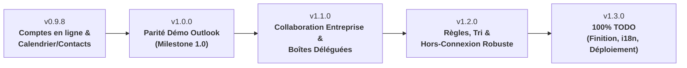

# Feuille de route (Roadmap) - Evolution Windows Port

Ce document définit la trajectoire de développement pour implémenter 100 % des fonctionnalités restantes du fichier [TODO.md](TODO.md), à partir de la version courante **0.9.7** (définie dans [VERSION](VERSION)).

Le plan est articulé autour de 5 versions jalons progressives :
- **v0.9.8** : Synchronisation en ligne et cycle de vie des données (Microsoft 365 et Gmail)
- **v1.0.0** : Parité démo « Remplaçant d\'Outlook » (milestone majeure)
- **v1.1.0** : Collaboration d\'entreprise, boîtes déléguées et catégories
- **v1.2.0** : Règles, traitement automatique et mode hors-connexion robuste
- **v1.3.0** : Couverture à 100 % du TODO (déploiement d\'entreprise, import/export, i18n)

---

## Version 0.9.8 — Synchronisation en ligne & cycle de vie des données (M365 & Gmail)

> **Objectif :** Raccorder de bout en bout les calendriers et carnets d\'adresses distants pour les comptes Microsoft 365 et Google, et compléter l\'édition directe.

### 1. Comptes & Services distants (§3)
- [ ] **Microsoft 365 / Exchange Online** : validation de bout en bout de la collection `microsoft365` (Microsoft Graph) pour synchroniser calendriers et contacts (`#demo-cal-contacts-m365`). _(reste à valider sur un tenant réel : code et paramètres en place)_
- [x] **Gmail / Google Workspace** : création automatique de la collection Google (CalDAV, CardDAV / Google People API) avec réutilisation du jeton OAuth2 existant (`#demo-cal-contacts-gmail`).
- [x] **Bouton d\'activation a posteriori** : option « Activer le calendrier et les contacts » pour les comptes Gmail déjà configurés sans ces portées.
- [x] **Gestion des contacts en ligne** : modification et synchronisation bidirectionnelle des fiches contacts distantes (`#demo-gestion-contacts`).

### 2. Calendrier (§13)
- [x] **Fenêtre d\'édition d\'événement** : fenêtre modifiable complète pour créer, modifier et supprimer des événements (dates, participants, lieu, description).
- [x] **Prise en charge des fuseaux horaires et alertes** : enregistrement des rappels d\'événements et prise en compte propre des fuseaux horaires.
- [x] **Actualisation manuelle et automatique** : bouton d\'actualisation et intégration des modifications effectuées sur d\'autres clients (Outlook Web, Google Agenda).

### 3. Application, installation & mises à jour (§1)
- [x] **Téléchargement automatique des mises à jour** : rapatriement en tâche de fond du MSI depuis GitHub Releases avec barre de progression.
- [x] **Contrôle d\'intégrité** : vérification de l\'empreinte SHA-256 et validation de la signature Authenticode avant installation.

---

## Version 1.0.0 — Jalon Démo « Remplaçant d\'Outlook »

> **Objectif :** Finaliser tous les points indispensables de la liste de priorités Démo et offrir une expérience utilisateur fluide au quotidien.

### 1. Mail & Lecture (§5, §6, §7)
- [x] **Regroupement par discussion** : affichage hiérarchique sous forme de conversations / fils de discussion (`#demo-conversations`).
- [x]**Gestion des dossiers** : réorganisation ordonnée des dossiers spéciaux en tête (Boîte de réception, Envoyés, Brouillons) avec icônes distinctives (`#demo-dossiers`).
- [x] **Pièces jointes** : prévisualisation intégrée (images, texte, PDF, HTML), enregistrement groupé et glisser-déposer sortant. _(aperçu Office reporté : cf. TODO §6)_
- [x] **Suivi des messages** : options de marquage d\'importance, drapeaux avec date d\'échéance et rappels associés.
- [x] **Accusés de lecture et de réception** : gestion de l\'émission et du traitement des notifications d\'état de distribution.

### 2. Invitations & Réunions (§13, §15)
- [x] **Traitement des invitations iCalendar** : bandeau d\'action dans le volet de lecture (Accepter, Refuser, Provisoire) avec mise à jour du calendrier de l\'utilisateur (`#demo-invitations`).
- [ ] **Carnet d\'adresses global (GAL)** : recherche et consultation de l\'annuaire d\'entreprise pour Exchange Online et Microsoft 365 (`#demo-gal`). _Implémenté (moteur Microsoft Graph et Google, autocomplétion des destinataires, consultation depuis la vue Contacts, tests) ; reste à valider sur un tenant réel (Microsoft 365) avant de cocher._
- [ ] **Réunion en ligne Microsoft Teams** (compte Exchange Online / Microsoft 365) : bouton « Réunion Teams » du ruban Calendrier, création via Microsoft Graph (`isOnlineMeeting: true`, `teamsForBusiness`) et lien de visio inséré dans l'invitation. _(codé : case « Réunion en ligne Microsoft Teams » dans la fenêtre d'événement et bouton du ruban ; reste à valider sur un tenant réel)_

### 3. Gestion des absences (§3)
- [ ] **Réponses automatiques (Out of Office)** : interface de configuration des messages d\'absence pour Microsoft 365 et Gmail (`#demo-reponses-auto`). _Implémenté (moteur, boîte de dialogue, tests) ; reste à valider sur un compte réel (tenant M365, compte Gmail) avant de cocher._

---

## Version 1.1.0 — Collaboration d\'entreprise, boîtes déléguées & catégories

> **Objectif :** Couvrir les besoins avancés des organisations (secrétariat, équipes d\'assistance, boîtes partagées et classement transverse).

### 1. Boîtes partagées & Délégations (§3)
- [ ] **Ouverture dynamique de boîtes déléguées** : ajout d\'une boîte ou d\'un calendrier partagé via clic droit sur un compte Exchange / M365.
- [ ] **Envoi délégué** : prise en charge des modes « En tant que » (*Send As*) et « De la part de » (*Send on Behalf*).
- [ ] **Boîte d\'archivage en ligne (*In-Place Archive*)** : détection et affichage d\'un nœud d\'archives distant séparé.
- [ ] **Éléments récupérables (*Recoverable Items*)** : restauration en libre-service des éléments supprimés sur Exchange Online.
- [ ] **Gestion des autorisations déléguées** : consultation et révocation des droits accordés depuis l\'interface d\'EvolutionWin.

### 2. Catégorisation transverse (§17)
- [x] **Système de catégories unifiées** : palette de codes couleur et libellés partagés entre e-mails, contacts, tâches et événements de calendrier (`#demo-categories`).
- [x] **Filtres par catégorie** : filtrage rapide dans les listes selon les catégories attribuées.

### 3. Vues unifiées multi-comptes (§11)
- [x] **Boîte de réception unifiée** : vue agrégée virtuelle (`CamelVeeFolder`) regroupant les messages reçus de l\'ensemble des comptes.
- [x] **Dossiers virtuels globaux** : regroupement des éléments envoyés, de la corbeille et des brouillons sur tous les comptes.

---

## Version 1.2.0 — Règles, traitement automatique & hors-connexion robuste

> **Objectif :** Automatiser le tri des flux de messages volumineux et garantir un fonctionnement nomade déconnecté sans perte de données.

### 1. Règles & Courrier indésirable (§8)
- [ ] **Éditeur graphique de règles** : création de filtres sur critères multiples (expéditeur, objet, destinataires, en-têtes) et actions (déplacement, copie, marquage).
- [ ] **Règles côté serveur** : synchronisation des règles vers Exchange Online / EWS et support du protocole ManageSieve pour les serveurs IMAP compatibles.
- [ ] **Filtrage anti-spam** : intégration locale de moteurs de classification (Bogofilter, SpamAssassin ou analyse bayésienne).

### 2. Mode hors-connexion et synchronisation fine (§4)
- [ ] **Plages de synchronisation par dossier** : réglage de la rétention locale (ex. 1 mois, 6 mois, 1 an, tout l\'historique).
- [ ] **File d\'attente d\'actions hors-ligne** : exécution différée des suppressions, déplacements et envois avec réconciliation automatique à la reconnexion.
- [ ] **Résolution des conflits** : détection et arbitrage des modifications concurrentes sur les calendriers et contacts.

### 3. Moteur de recherche avancé (§10)
- [ ] **Indexation plein texte locale** : recherche instantanée dans le corps des messages et le contenu des pièces jointes indexables.
- [ ] **Dossiers de recherche enregistrés** : création de dossiers dynamiques basés sur des requêtes de recherche persistantes.

---

## Version 1.3.0 — Couverture à 100 % du TODO (déploiement, import/export, i18n)

> **Objectif :** Clôturer l\'ensemble des points restants de [TODO.md](TODO.md), peaufiner l\'administration et finaliser l\'internationalisation.

### 1. Déploiement & Administration d\'entreprise (§1)
- [ ] **Installation silencieuse avancée du MSI** : support complet des propriétés `FORCECLOSE=1`, `PURGEUSERDATA=1` et arrêt propre multi-sessions.
- [ ] **Stratégies de groupe (GPO / Registre)** : verrouillage centralisé de paramètres (désactivation des mises à jour automatiques, configuration imposée).

### 2. Importation & Exportation (§18)
- [ ] **Assistant d\'importation** : prise en charge des conteneurs Outlook (fichiers `.pst` et `.ost`) et des profils tiers (Thunderbird MBOX / Maildir).
- [ ] **Exportation de données** : export complet de dossiers ou de sélections aux formats standard (`.eml`, `.mbox`, `.ics`, `.vcf`).

### 3. Ergonomie avancée, protocoles & Traductions (§2, §6, §19, §20)
- [ ] **Lecteur immersif** : vue plein écran épurée dédiée à la lecture concentrée.
- [ ] **Enregistrement système `mailto:`** : enregistrement en tant que client de messagerie par défaut auprès de Windows 11.
- [x] **Traduction et internationalisation** : infrastructure de ressources `.resw` / MRT Core opérationnelle (`I18n.h`, `TRANSLATIONS.md`), catalogues multilingues complets (`fr-FR`, `en-US`, `de-DE`, `it-IT`, `es-ES`, `pt-PT`, `nl-NL`) et support de déploiement MSI (`UILANGUAGE`).
- [ ] **Revue finale des critères de conformité** : validation croisée de toutes les cases de [TODO.md](TODO.md).

