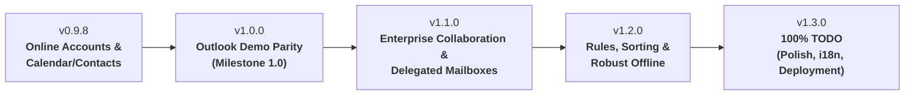

# Roadmap - Evolution Windows Port

This document defines the development path to implement 100% of the remaining features of [TODO.md](TODO.md), starting from the current version **1.1.4** (in progress, defined in [VERSION](VERSION)).

The plan is built around 5 progressive milestone versions:
- **v0.9.8**: Online synchronization and data lifecycle (Microsoft 365 and Gmail)
- **v1.0.0**: "Outlook replacement" demo parity (major milestone)
- **v1.1.0**: Enterprise collaboration, delegated mailboxes and categories
- **v1.2.0**: Rules, automatic processing and robust offline mode
- **v1.3.0**: 100% TODO coverage (enterprise deployment, import/export, i18n)

---

## Version 0.9.8 — Online synchronization & data lifecycle (M365 & Gmail)

> **Goal:** Wire up remote calendars and address books end to end for Microsoft 365 and Google accounts, and complete direct editing.

### 1. Remote accounts & services (§3)
- [ ] **Microsoft 365 / Exchange Online**: end-to-end validation of the `microsoft365` collection (Microsoft Graph) to synchronize calendars and contacts (`#demo-cal-contacts-m365`). _(still to be validated on a real tenant: code and settings in place)_
- [x] **Gmail / Google Workspace**: automatic creation of the Google collection (CalDAV, CardDAV / Google People API) reusing the existing OAuth2 token (`#demo-cal-contacts-gmail`).
- [x] **After-the-fact activation button**: "Activer le calendrier et les contacts" option for Gmail accounts already configured without these scopes.
- [x] **Online contact management**: editing and two-way synchronization of remote contact cards (`#demo-gestion-contacts`).

### 2. Calendar (§13)
- [x] **Event editing window**: full editable window to create, modify and delete events (dates, attendees, location, description).
- [x] **Time zone and alert support**: saving of event reminders and clean handling of time zones.
- [x] **Manual and automatic refresh**: refresh button and integration of changes made from other clients (Outlook Web, Google Calendar).

### 3. Application, installation & updates (§1)
- [x] **Automatic update download**: background retrieval of the MSI from GitHub Releases with a progress bar.
- [x] **Integrity check**: SHA-256 hash verification and Authenticode signature validation before installation.

---

## Version 1.0.0 — "Outlook replacement" demo milestone

> **Goal:** Finalize every essential item on the demo priority list and deliver a smooth day-to-day user experience.

### 1. Mail & Reading (§5, §6, §7)
- [x] **Conversation grouping**: hierarchical display as conversations / threads (`#demo-conversations`).
- [x] **Folder management**: ordered reorganization of special folders at the top (Inbox, Sent, Drafts) with distinctive icons (`#demo-dossiers`).
- [x] **Attachments**: built-in preview (images, text, PDF, HTML), grouped saving and outgoing drag and drop. _(Office preview postponed: see TODO §6)_
- [x] **Message tracking**: importance flagging options, flags with due date and associated reminders.
- [x] **Read and delivery receipts**: handling of sending and processing delivery status notifications.

### 2. Invitations & Meetings (§13, §15)
- [x] **iCalendar invitation handling**: action banner in the reading pane (Accept, Decline, Tentative) with update of the user's calendar (`#demo-invitations`).
- [ ] **Global Address List (GAL)**: search and browsing of the corporate directory for Exchange Online and Microsoft 365 (`#demo-gal`). _Implemented (Microsoft Graph and Google engine, recipient autocompletion, browsing from the Contacts view, tests); still to be validated on a real tenant (Microsoft 365) before checking._
- [x] **Microsoft Teams online meeting** (Exchange Online / Microsoft 365 account): "Réunion Teams" button in the Calendar ribbon, creation through Microsoft Graph (`isOnlineMeeting: true`, `teamsForBusiness`) and video link inserted in the invitation. _(coded: "Réunion en ligne Microsoft Teams" checkbox in the event window and ribbon button; still to be validated on a real tenant)_

### 3. Absence management (§3)
- [x] **Automatic replies (Out of Office)**: configuration interface for out-of-office messages for Microsoft 365 and Gmail (`#demo-reponses-auto`). _Implemented (engine, dialog, tests); still to be validated on a real account (M365 tenant, Gmail account) before checking._

---

## Version 1.1.0 — Enterprise collaboration, delegated mailboxes & categories

> **Goal:** Cover the advanced needs of organizations (secretarial work, support teams, shared mailboxes and cross-cutting classification).

### 1. Shared mailboxes & Delegations (§3)
- [x] **Dynamic opening of delegated mailboxes**: adding a shared mailbox or calendar through right-click on an Exchange / M365 account. _(done in 1.1.0: shared mail, calendar and contacts; "Fermer la boîte partagée"; validated on a real tenant for mail)_
- [x] **Delegated sending**: support for "En tant que" (*Send As*) and "De la part de" (*Send on Behalf*) modes. _("En tant que" done and validated; "De la part de" coded (From = shared mailbox, Sender = user, through the originating account), still to be validated on a real tenant)_
- [x] **Recoverable Items**: self-service restoration of deleted items on Exchange Online. _(done in 1.1.0: resizable window, restore or permanent deletion; validated)_

- [x] **Focused Inbox**: Focused / Other tabs with counters, move by right-click and per-sender rule, per-account setting. _(done in 1.1.0; to be validated on a real tenant)_
- [x] **Mail favorites**: Favorites section at the top of the folder pane, reorderable. _(done in 1.1.0)_

### 2. Cross-cutting categorization (§17)
- [x] **Unified category system**: palette of color codes and labels shared between e-mails, contacts, tasks and calendar events (`#demo-categories`).
- [x] **Category filters**: quick filtering in lists according to the assigned categories.

### 3. Unified multi-account views (§11)
- [x] **Unified inbox**: virtual aggregated view (`CamelVeeFolder`) gathering the messages received across all accounts.
- [x] **Global virtual folders**: grouping of sent items, trash and drafts across all accounts.

---

## Version 1.2.0 — Rules, automatic processing & robust offline

> **Goal:** Automate the sorting of high-volume message flows and guarantee disconnected nomadic operation without data loss.

### 1. Rules & Junk mail (§8)
- [x] **Graphical rule editor**: creation of filters on multiple criteria (sender, subject, recipients, headers) and actions (move, copy, flag).
- [x] **Quick rule editor**: quick creation of rules from a right-click on a mail.
- [x] **Server-side rules**: synchronization of rules to Exchange Online (Graph) and support of the ManageSieve protocol for compatible IMAP servers. _(still to be validated on real accounts; on-premises EWS not supported)_
- [x] **Anti-spam filtering**: local integration of classification engines (Bogofilter, SpamAssassin or Bayesian analysis). _(standalone local Bayesian analysis; still to be validated on real accounts)_

### 2. Offline mode and fine-grained synchronization (§4)
- [x] **Per-folder synchronization ranges**: local retention setting (e.g. 1 month, 6 months, 1 year, entire history). _(coded: right-click on an account or folder › "Synchronisation hors connexion…"; still to be validated on a real IMAP account)_
- [x] **Offline action queue**: deferred execution of deletions, moves and sends with automatic reconciliation on reconnection. _(coded: on-disk journal, replay, reconciliation, list and cancellation in the status bar; still to be validated on a real account)_
- [x] **Conflict resolution**: detection and arbitration of concurrent modifications on calendars and contacts. _(coded: revision / ETag and "Garder la version locale / distante / les deux" dialog; still to be validated on real CalDAV, CardDAV and EWS)_

### 3. Advanced search engine (§10)
- [x] **Local full-text indexing**: instant search in message bodies and the content of indexable attachments. _(in-house inverted index; text attachments only, PDF/Office not extracted; non-downloaded messages and Microsoft 365: Camel search; still to be validated on a real IMAP account)_
- [x] **Saved search folders**: creation of dynamic folders based on persistent search queries. _(done in 1.1.0: templates and operators `is:unread`, `has:attachment`, `larger:`, `from:`; brought forward from this milestone)_

### 4. Shared mailboxes & delegations (postponed from 1.1.0, §3)

- [ ] **Online archive mailbox (*In-Place Archive*)**: detection and display of a separate remote archive node. _(blocked: Microsoft Graph does not expose the online archive, no EWS/Graph backend of evolution-ews handles it)_
- [ ] **Delegated permission management**: viewing and revoking granted rights from the EvolutionWin interface. _(Exchange Online: no Graph API for FullAccess / SendAs / SendOnBehalf; Gmail: coded, right-click on the account › "Délégations et autorisations…", still to be validated on a Google Workspace account)_

---

## Version 1.3.0 — 100% TODO coverage (deployment, import/export, i18n)

> **Goal:** Close all remaining items of [TODO.md](TODO.md), polish administration and finalize internationalization.

### 1. Enterprise deployment & administration (§1)
- [x] **Advanced silent MSI installation**: full support for the `FORCECLOSE=1`, `PURGEUSERDATA=1` properties and clean multi-session shutdown. _(coded: to be validated on a VM, including multi-session)_
- [x] **Group Policy (GPO / Registry)**: centralized locking of settings (disabling automatic updates, enforced configuration). _(coded: `Policy.h`, ADMX/ADML template, `DisableAutoUpdate` and enforced settings; to be validated with a real GPO)_

### 2. Import & Export (§18)
- [ ] **Import wizard**: support for Outlook containers (`.pst` and `.ost` files) and third-party profiles (Thunderbird MBOX / Maildir). _(done: mbox, EML, Maildir, Thunderbird profile (profile detection and folder tree), vCard, iCalendar; not done: `.pst` / `.ost`, proprietary format with no available library (libpst absent from the stack) — the wizard detects the case and explains the conversion to mbox with `readpst`)_
- [x] **Data export**: full export of folders or selections in standard formats (`.eml`, `.mbox`, `.ics`, `.vcf`). _(coded: File › Export data… wizard, mbox / EML with date range, `.ics` / `.vcf` through the existing wizards; still to be validated by hand: see VALIDATION.md)_

### 3. Advanced ergonomics, protocols & Translations (§2, §6, §19, §20)
- [x] **Immersive reader**: clean full-screen view dedicated to focused reading. _(done: View ribbon, text only, adjustable size / spacing / theme, Esc to exit; to be validated by hand)_
- [x] **System `mailto:` registration**: registration as the default mail client with Windows 11. _(done: Settings > Mail, opening a compose window from a link, forwarding to the running instance; MSI option not done; to be validated by hand)_
- [x] **Translation and internationalization**: working `.resw` / MRT Core resource infrastructure (`I18n.h`, `TRANSLATIONS.md`), complete multilingual catalogs (`fr-FR`, `en-US`, `de-DE`, `it-IT`, `es-ES`, `pt-PT`, `nl-NL`) and MSI deployment support (`UILANGUAGE`).
- [ ] **Final review of compliance criteria**: cross-validation of all boxes in [TODO.md](TODO.md).
